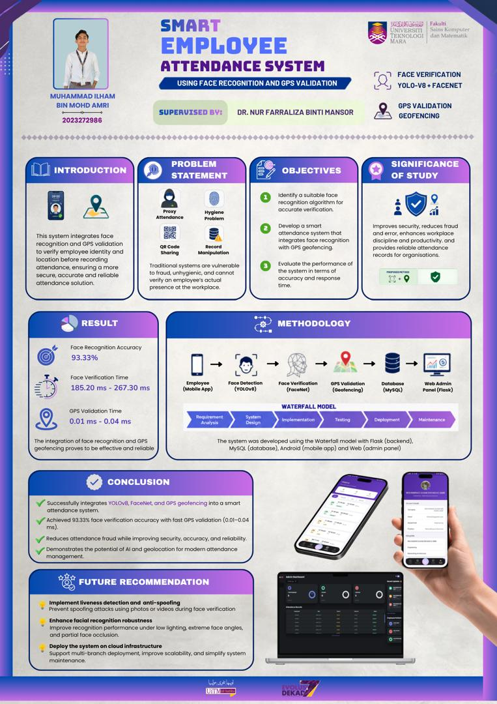

# Smart Employee Attendance System Using Face Recognition and GPS Validation

An Android-based employee attendance management system that integrates deep learning-based face recognition with GPS geofencing to improve attendance verification, reduce proxy attendance, and support reliable attendance monitoring.

## Project Poster



## Project Overview

Traditional attendance methods such as manual recording, fingerprint scanning, and QR code systems may have limitations in verifying employee identity and physical presence.

This project combines facial identity verification and GPS-based location validation to ensure that attendance attempts are checked against both employee identity and workplace location.

The system consists of an Android mobile application for employees, a Flask-based backend, a MySQL database, and a web-based administrative dashboard.

## Key Features

- **Face Detection:** Uses YOLOv8 face detection to locate faces in captured images.
- **Face Verification:** Uses FaceNet-based facial embeddings to support employee identity verification.
- **GPS Geofencing:** Validates employee location against the permitted workplace radius.
- **Employee Attendance:** Supports clock-in and clock-out operations through the Android application.
- **Attendance Management:** Stores and displays attendance records.
- **Admin Dashboard:** Provides administrative functions for managing employees and monitoring attendance.
- **Attendance Reports:** Supports attendance reporting and PDF report generation.
- **Messaging:** Provides messaging functionality between employees and administrators.

## System Architecture

The system follows a client-server architecture.

1. The employee uses the Android application to initiate an attendance attempt.
2. The backend processes face detection and identity verification.
3. GPS coordinates are checked against the configured workplace geofence.
4. The backend communicates with the MySQL database to retrieve or store relevant records.
5. The administrative dashboard provides access to attendance information and management functions.

**Architecture overview:**

`Android App → Flask REST API → Face Verification + GPS Validation → MySQL Database → Admin Dashboard`

## Technologies Used

| Component | Technology |
|---|---|
| Mobile Application | Android Studio, Java, XML |
| Backend | Python, Flask |
| Face Detection | YOLOv8 |
| Face Verification | FaceNet |
| Image Processing | OpenCV, NumPy |
| Database | MySQL |
| Web Interface | HTML, CSS, JavaScript, Flask Templates |
| PDF Reporting | ReportLab |
| Development Methodology | Waterfall Model |

## Results and Performance

The system was evaluated through functional testing and performance testing.

| Evaluation Metric | Result |
|---|---|
| Face Verification Success | 14 out of 15 attempts (93.33%) |
| GPS Validation Success | 13 out of 15 attempts (86.67%) |
| Face Verification Time | 185.20–267.30 ms |
| GPS Validation Time | 0.01–0.04 ms |

The tests demonstrated that the system could perform identity and location verification during attendance attempts. The GPS tests also demonstrated rejection of attempts outside the configured geofencing radius.

*Note: These figures reflect the recorded test results and the tested conditions. They should not be interpreted as guaranteed performance in every real-world environment.*

## Application Screenshots

Screenshots of the actual application interfaces will be added here.

### 1. Employee Mobile Application

<!-- Add the Android application screenshot here -->

### 2. Face Verification

<!-- Add the face verification interface here -->

### 3. GPS Location Validation

<!-- Add the GPS validation interface here -->

### 4. Admin Dashboard

<!-- Add the web-based admin dashboard screenshot here -->

### 5. Attendance Records and Reports

<!-- Add the attendance history or reporting interface here -->

## Repository Structure

```text
smart-employee-attendance-system/
├── app/                  # Android application source code
├── backend/              # Flask backend and web dashboard
│   ├── app.py
│   ├── requirements.txt
│   ├── yolov8n-face.pt
│   ├── static/
│   └── templates/
├── database/             # MySQL database schema
│   └── smart-attendance-schema.sql
├── gradle/               # Gradle wrapper files
├── README.md
├── build.gradle
├── gradle.properties
├── gradlew
├── gradlew.bat
└── settings.gradle
```

## Installation and Setup

### Prerequisites

- Android Studio
- Python
- MySQL Server and MySQL Workbench
- Git
- Required Python packages listed in `backend/requirements.txt`

### 1. Clone the Repository

```bash
git clone https://github.com/ilhum.../smart-employee-attendance-system.git
cd smart-employee-attendance-system
```

Replace the example GitHub username in the URL with the actual repository URL.

### 2. Set Up the Database

1. Start MySQL Server.
2. Create the required database.
3. Import `database/smart-attendance-schema.sql` into MySQL.
4. Configure the database connection settings required by the Flask backend.

Do not publish database passwords or real employee records.

### 3. Set Up the Backend

Navigate to the backend directory:

```bash
cd backend
```

Create and activate a Python virtual environment:

```bash
python -m venv venv
```

On Windows:

```bash
venv\Scripts\activate
```

Install the dependencies:

```bash
pip install -r requirements.txt
```

Configure the database connection, Flask settings, and model path before running the application. Ensure that the required TensorFlow/Keras dependencies for FaceNet are installed and compatible with the project.

Start the Flask application using the entry point and configuration defined in `app.py`.

### 4. Run the Android Application

1. Open the repository's Android project in Android Studio.
2. Allow Gradle to synchronise.
3. Configure the backend API URL for the target device or emulator.
4. Run the application on a compatible Android device.

The Android application requires access to the backend and appropriate location permissions for GPS validation.

## Limitations and Future Improvements

- Implement liveness detection and anti-spoofing to strengthen protection against photo or video spoofing attempts.
- Improve face verification under low-light conditions and extreme face angles.
- Evaluate performance with a larger and more diverse test dataset.
- Consider cloud deployment to support multiple workplace branches.
- Improve deployment, configuration management, and monitoring for production use.

## Security and Privacy

This project involves facial images and employee attendance information. Real employee images, biometric data, passwords, API keys, and database credentials must not be published in this repository.

Use test data when demonstrating the application.

## Project Information

**Project:** Smart Employee Attendance System Using Face Recognition and GPS Validation

**Development Approach:** Waterfall Model

**Project Type:** Final Year Project

---

*Developed as an academic project exploring facial verification, GPS geofencing, mobile application development, and attendance management.*
